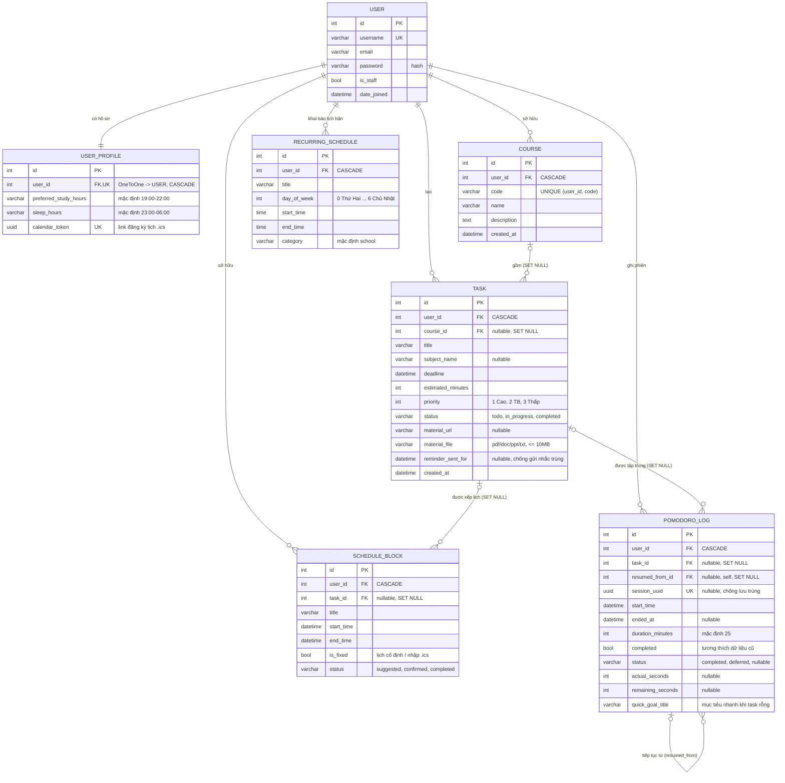

# AI Study Planner

Ứng dụng web giúp sinh viên tổ chức nhiệm vụ, khóa học và thời gian học. Dự án dùng Django Templates (HTML), CSS và JavaScript ở giao diện; Django xử lý nghiệp vụ và PostgreSQL lưu dữ liệu.

## Mục lục

- [Đối chiếu yêu cầu đề bài](#đối-chiếu-yêu-cầu-đề-bài-nhóm-4--web-4)
- [Chức năng](#chức-năng)
- [Luồng sử dụng](#luồng-sử-dụng)
- [Công nghệ và yêu cầu](#công-nghệ-và-yêu-cầu)
- [Cài đặt và chạy](#cài-đặt-và-chạy)
- [Dữ liệu mẫu](#dữ-liệu-mẫu)
- [ERD và mô hình dữ liệu](#erd-và-mô-hình-dữ-liệu)
- [Các trang và API](#các-trang-và-api)
- [Cấu trúc tệp và vai trò](#cấu-trúc-tệp-và-vai-trò)
- [Cấu hình trợ lý AI](#cấu-hình-trợ-lý-ai)
- [Kiểm thử](#kiểm-thử)
- [Triển khai](#triển-khai)

## Đối chiếu yêu cầu đề bài (Nhóm 4 – WEB 4)

| Task | Yêu cầu | Đã làm trong mã nguồn | Demo |
|---|---|---|---|
| **T1** ERD, auth, khung ứng dụng | Model User/Course/Task/Event, migration, đăng nhập, seed | `planner/models.py` (Event = `ScheduleBlock`), 6 migration, `/login/`, `/register/`, trang CRUD môn học `/courses/`, lệnh `seed_demo_data` (4 môn, **8 task**, lịch bận tuần) | ERD bên dưới + trang đăng nhập |
| **T2** Lịch, deadline, tài liệu, nhắc việc | CRUD sự kiện/deadline, giao diện lịch, đồng bộ .ics, gắn tài liệu, scheduler nhắc việc | FullCalendar kéo thả; **xuất .ics + link đăng ký tự cập nhật (`/calendar/feed/<token>.ics`) + nhập .ics**; tải file tài liệu; nhắc việc 3 lớp: chuông + thông báo trình duyệt trong app, email qua **Celery Beat (15 phút/lần)** hoặc lệnh `send_deadline_reminders` | Tạo task hạn < 24h → chuông đỏ + notification + email |
| **T3** Thuật toán sinh kế hoạch tuần | Xếp lịch theo ưu tiên/thời lượng/lịch bận, cho chỉnh sửa, unit test | `planner/scheduler.py`: `compute_free_slots` + `plan_sessions` (hàm thuần), phiên ≤ 90 phút, nghỉ 10 phút, không vượt deadline, ≤ 4 giờ/ngày; kéo thả/sửa → `confirmed` và được giữ khi sinh lại; 9 unit test | `seed_demo_data` → **Lập lịch tuần** từ 8 task mẫu |
| **T4** Pomodoro & UX | Bộ đếm, lưu phiên, thống kê, thông báo | Pomodoro Workspace (`/pomodoro/`), API lưu phiên/thống kê/heatmap, thông báo trình duyệt khi hết phiên | Chạy một phiên rồi xem thống kê |
| **T5** AI phân bổ thời gian, cảnh báo trễ, deploy | Điểm rủi ro trễ hạn, AI tóm tắt ngày, kiểm thử, deploy | `planner/risk.py` (điểm 0–100, 5 thành phần), hiển thị trên Tổng quan + Trợ lý AI + `/api/risk/`; OpenAI tóm tắt ngày (có dự phòng khi không có key); 43 test; `render.yaml`, `Procfile` | Task gần hạn hiện **Rủi ro cao** kèm lý do |

### Công nghệ theo yêu cầu

| Yêu cầu | Trạng thái |
|---|---|
| Django (web thuần Python) | ✅ Django 6 + Django Templates, Tailwind CSS |
| FastAPI cho API phụ trợ | ✅ `planner/fastapi_app.py`, gắn tại `/api/v2` (Swagger `/api/v2/docs`) qua `core/asgi.py` |
| PostgreSQL | ✅ qua `DATABASE_URL` (Render/Supabase); SQLite khi chạy cục bộ không có biến này |
| Redis/Celery cho background jobs | ✅ `core/celery.py`, `planner/tasks.py`, Beat gửi nhắc deadline |
| OpenAI/Claude hỗ trợ | ✅ OpenAI (`OPENAI_API_KEY`), không bắt buộc |
| Deploy Render/Fly.io/Railway | ✅ `render.yaml` (web + Postgres + Redis + worker), `Procfile` (Railway) |

### Công thức điểm rủi ro trễ hạn (T5)

```
remaining = estimated_minutes − phút Pomodoro đã tập trung
capacity  = min(phút còn lại tới hạn, max(240, giờ_còn_lại/24 × 240))
score = 50 × min(remaining / capacity, 1)        # áp lực thời gian
      + 20 (≤24h) | 12 (≤72h) | 6 (≤7 ngày)       # độ gấp
      + 10 (ưu tiên cao) | 5 (trung bình)
      + 10 nếu chưa bắt đầu và còn ≤ 72h
      + 10 × tỉ lệ khối lượng chưa được xếp lịch
Đã xong = 0, quá hạn = 100. ≥ 70: cao, ≥ 40: trung bình.
```

## Chức năng

### Tài khoản

- Đăng ký tài khoản với tên đăng nhập, email và mật khẩu.
- Đăng nhập, đăng xuất bằng hệ thống xác thực Django.
- Tạo hồ sơ học tập mặc định cho tài khoản mới.
- Các trang quản lý nhiệm vụ, lịch, Pomodoro và trợ lý AI yêu cầu đăng nhập.

### Khóa học và nhiệm vụ

- Tạo nhiệm vụ gồm tiêu đề, môn học, hạn chót, thời lượng ước tính, mức ưu tiên, liên kết hoặc file tài liệu ôn tập.
- Tải file PDF, Word, PowerPoint hoặc TXT tối đa 10 MB; file chỉ được tải qua trang đã đăng nhập và chủ nhiệm vụ.
- Mặc định file lưu tại `MEDIA_ROOT` trên máy chủ; môi trường production cần ổ lưu trữ bền vững và riêng tư.
- Liên kết tùy chọn một nhiệm vụ với một khóa học.
- Chỉ hiển thị các khóa học của tài khoản hiện tại trong biểu mẫu nhiệm vụ.
- Nếu chọn khóa học nhưng để trống tên môn học cũ, ứng dụng tự điền tên khóa học để các phần hiện tại tiếp tục hiển thị môn học.
- Tạo, xem, sửa, đánh dấu hoàn thành/làm lại và xóa deadline/nhiệm vụ.
- Gửi email nhắc các nhiệm vụ chưa hoàn thành khi deadline nằm trong 24 giờ tới; mỗi deadline chỉ được nhắc một lần.
- Chạy chế độ demo nhắc hạn để xem trước người nhận và nhiệm vụ mà không gửi email hoặc ghi trạng thái.
- Các thao tác cập nhật trạng thái và xóa dùng POST có CSRF; chỉ chủ sở hữu mới có quyền sửa dữ liệu.
- `Course` hiện có model và có thể quản lý trong Django Admin/seed; dự án chưa có trang CRUD khóa học riêng.

### Lịch học

- Khai báo thời khóa biểu/lịch bận lặp lại theo thứ trong tuần.
- Xem deadline và các khối thời gian trên lịch.
- Tạo sự kiện lịch thủ công, liên kết tùy chọn với nhiệm vụ, sửa hoặc xóa sự kiện.
- Chọn deadline trên lịch để mở trang chỉnh sửa nhiệm vụ; chọn sự kiện thủ công để chỉnh sửa/xóa.
- Kéo thả hoặc thay đổi thời lượng sự kiện thủ công để cập nhật thời gian.
- Tải lịch dưới dạng iCalendar `.ics` để nhập vào ứng dụng lịch khác. Đây là xuất một chiều; chưa có đồng bộ trực tiếp hoặc nhập ngược từ lịch ngoài.
- Lịch cố định được sinh từ quy tắc lặp lại chỉ xem trên lịch; có thể thêm hoặc xóa quy tắc tại trang lịch bận cố định.
- Tạo lịch học tuần tự động từ nhiệm vụ còn mở và các khối thời gian bận. Nhiệm vụ được xét theo mức ưu tiên rồi đến deadline.
- `ScheduleBlock` là model khối lịch hiện có, đồng thời được dùng làm `Event` trong ERD; dự án không tạo model Event riêng.

### Pomodoro

- Chọn nhiệm vụ đã lên lịch hoặc đặt mục tiêu nhanh (Quick Goal) để bắt đầu phiên tập trung.
- Giao diện chia thành các trạng thái trước phiên, đang tập trung và sau phiên; có lựa chọn hình nền, nhạc, tóm tắt phiên và thông tin chuỗi ngày học.
- Lưu phiên hoàn thành hoặc gác lại, thời gian tập trung thực tế, thời gian còn lại và liên kết phiên tiếp tục.
- Thống kê tổng thời gian, số phiên hoàn thành, streak hiện tại và dữ liệu heatmap theo ngày.
- Phiên gác lại không được tính vào thống kê hoàn thành. Mã phiên UUID được dùng để hạn chế lưu trùng.

### Trợ lý AI

- Phân tích nhiệm vụ chưa hoàn thành, deadline, mức ưu tiên và lịch sử Pomodoro 7 ngày gần nhất.
- Khi có `OPENAI_API_KEY`, gọi OpenAI để tạo tóm tắt, cảnh báo rủi ro và lời khuyên học tập.
- Khi không có API key, tạo phân tích dự phòng dựa trên số liệu nhiệm vụ/Pomodoro, không cần gọi dịch vụ AI.

## Luồng sử dụng

1. Tạo tài khoản tại `/register/` hoặc đăng nhập tại `/login/`.
2. Tạo nhiệm vụ trên trang chủ (`/`); nếu đã có khóa học, có thể chọn khóa học trong biểu mẫu. Có thể nhập đường dẫn tài liệu hoặc tải file; file chỉ người sở hữu nhiệm vụ mới truy cập được.
3. Khai báo các lịch học/lịch bận định kỳ tại `/recurring/`.
4. Mở `/calendar/` để xem deadline và lịch; dùng chức năng lập lịch tự động nếu muốn tạo các khối học trong tuần.
   Bấm **Đồng bộ .ics** để: sao chép link đăng ký lịch (dán vào Google Calendar → *Thêm lịch → Từ URL*; lịch tự cập nhật), tải tệp `.ics`, hoặc nhập tệp `.ics` (thời khóa biểu, lịch thi) thành lịch bận cố định.
5. Mở `/pomodoro/`, chọn nhiệm vụ hoặc Quick Goal, bắt đầu tập trung; khi kết thúc hoặc gác lại, phiên được gửi tới API để kiểm tra và lưu.
6. Xem thống kê/heatmap trong giao diện Pomodoro; các API chỉ trả dữ liệu thuộc người dùng hiện tại.
7. Mở `/ai-assistant/` để xem phân tích lịch học.
8. Dùng `/logout/` để đăng xuất.

### Nhắc deadline qua email

Lệnh kiểm tra deadline sắp tới mặc định trong 24 giờ. Chạy demo an toàn trước:

```powershell
python manage.py send_deadline_reminders --dry-run
```

Khi đã cấu hình email, chạy thật bằng:

```powershell
python manage.py send_deadline_reminders
```

Trong môi trường phát triển, email được in ra console. Để gửi email thực tế, cấu hình các biến môi trường SMTP `EMAIL_BACKEND`, `EMAIL_HOST`, `EMAIL_PORT`, `EMAIL_HOST_USER`, `EMAIL_HOST_PASSWORD`, `EMAIL_USE_TLS` và `DEFAULT_FROM_EMAIL`; không ghi thông tin xác thực vào Git. Ví dụ backend:

```text
EMAIL_BACKEND=django.core.mail.backends.smtp.EmailBackend
```

Để tự động chạy trên Windows, tạo tác vụ trong Task Scheduler với chương trình là `python.exe`, đối số `manage.py send_deadline_reminders`, thư mục bắt đầu là thư mục dự án và lịch lặp mỗi giờ. Trên máy chủ Linux, cấu hình cron gọi cùng lệnh. Mỗi lần chạy chỉ gửi một lần cho mỗi deadline; deadline được chỉnh sửa sẽ đủ điều kiện được nhắc lại. Người dùng phải có email và nhiệm vụ chưa hoàn thành. Có thể đặt `--hours-before 48` để đổi khoảng kiểm tra; lệnh chỉ xét deadline còn ở phía trước.

## Công nghệ và yêu cầu

- Python 3 (khuyến nghị Python 3.12 trở lên) và pip.
- Django; phiên bản trong danh sách phụ thuộc hiện được ghim là Django 6.1.2.
- PostgreSQL qua biến `DATABASE_URL` (Supabase/Render); không đặt thì dùng SQLite cục bộ.
- Redis + Celery (tùy chọn) cho nhắc deadline định kỳ; FastAPI cho API phụ trợ.
- OpenAI API là tùy chọn.
- Giao diện: Django Templates, HTML, CSS, JavaScript và các tài nguyên giao diện có trong `static/`.

## Cài đặt và chạy

### Windows (PowerShell)

```powershell
git clone https://github.com/Guarz/010100087202-LapTrinhPython.git
cd 010100087202-LapTrinhPython

python -m venv .venv
.\.venv\Scripts\Activate.ps1
python -m pip install -r requirements.txt
```

### macOS / Linux

```bash
git clone https://github.com/Guarz/010100087202-LapTrinhPython.git
cd 010100087202-LapTrinhPython

python3 -m venv .venv
source .venv/bin/activate
python -m pip install -r requirements.txt
```

Sao chép `.env.example` thành `.env`. Để trống `DATABASE_URL` sẽ dùng SQLite cục bộ; muốn dùng PostgreSQL/Supabase thì điền URL vào `.env` (không commit tệp này).

```bash
python manage.py migrate
python manage.py seed_demo_data --username demo --create-user   # tài khoản demo / demo12345
python manage.py runserver            # chỉ Django
uvicorn core.asgi:application --reload # Django + FastAPI (/api/v2/docs)
```

Mở [http://127.0.0.1:8000/](http://127.0.0.1:8000/). Tạo tài khoản quản trị Django nếu cần dùng trang Admin:

```bash
python manage.py createsuperuser
```

## Dữ liệu mẫu

Đầu tiên đăng ký tài khoản trong ứng dụng hoặc tạo tài khoản quản trị, sau đó chạy:

```bash
python manage.py seed_demo_data --username ten_dang_nhap
```

Nếu bỏ `--username`, lệnh chọn tài khoản đầu tiên trong cơ sở dữ liệu. Lệnh tạo 4 khóa học, 8 nhiệm vụ mẫu (dùng cho demo thuật toán xếp lịch), 5 lịch bận lặp lại và 2 khối lịch cho tài khoản đó; thêm `--create-user` để tự tạo tài khoản nếu chưa có; có thể chạy lại mà không tạo trùng dữ liệu mẫu. Lệnh không tạo tài khoản mới. Nếu chưa có tài khoản, lệnh báo lỗi và dừng.

## ERD và mô hình dữ liệu

ERD dưới đây khớp với `planner/models.py` hiện tại (bản đầy đủ kèm bảng ràng buộc: [docs/erd.md](docs/erd.md), ảnh: [docs/erd.svg](docs/erd.svg)). `User` là người dùng Django có sẵn; `Event` được biểu diễn bằng `ScheduleBlock` trong ứng dụng.



Mỗi khóa học thuộc một người dùng; mã khóa học (`code`) là duy nhất trong phạm vi người dùng đó. Khóa ngoại `Task.course` là tùy chọn để các nhiệm vụ cũ không cần gán khóa học. Khi xóa khóa học, nhiệm vụ vẫn tồn tại và quan hệ khóa học được đặt rỗng.

## Các trang và API

| Đường dẫn | Phương thức | Chức năng |
|---|---|---|
| `/` | GET/POST | Danh sách nhiệm vụ và biểu mẫu tạo nhiệm vụ |
| `/task/<id>/toggle/` | POST | Đổi trạng thái hoàn thành của nhiệm vụ |
| `/task/<id>/edit/` | GET/POST | Sửa deadline và thông tin nhiệm vụ |
| `/task/<id>/material/` | GET | Tải file tài liệu của nhiệm vụ (yêu cầu đăng nhập và đúng chủ sở hữu) |
| `/task/<id>/delete/` | POST | Xóa nhiệm vụ |
| `/register/` | GET/POST | Đăng ký tài khoản |
| `/login/` | GET/POST | Đăng nhập |
| `/logout/` | GET | Đăng xuất |
| `/calendar/` | GET | Giao diện lịch |
| `/calendar/export.ics` | GET | Tải deadline và sự kiện của người dùng đang đăng nhập dưới dạng iCalendar |
| `/calendar/events/new/` | GET/POST | Tạo sự kiện lịch thủ công |
| `/calendar/events/<id>/edit/` | GET/POST | Sửa sự kiện lịch thủ công |
| `/calendar/events/<id>/delete/` | POST | Xóa sự kiện lịch thủ công |
| `/api/calendar-events/` | GET | Dữ liệu sự kiện cho lịch |
| `/api/update-block-time/` | POST | Cập nhật thời gian khối lịch sau thao tác kéo thả |
| `/recurring/` | GET/POST | Danh sách và biểu mẫu lịch lặp lại |
| `/recurring/<id>/delete/` | POST | Xóa lịch lặp lại (chỉ chủ sở hữu) |
| `/auto-schedule/` | POST | Chạy lập lịch học tự động rồi chuyển về lịch |
| `/pomodoro/` | GET | Giao diện Pomodoro |
| `/api/save-pomodoro/` | POST JSON | Kiểm tra và lưu phiên Pomodoro |
| `/api/pomodoro-statistics/` | GET | Tổng thời gian, phiên hoàn thành và streak |
| `/api/pomodoro-heatmap/` | GET | Tổng thời gian tập trung theo ngày |
| `/ai-assistant/` | GET | Phân tích lịch học và deadline |
| `/courses/` | GET/POST | Danh sách và thêm môn học |
| `/courses/<id>/delete/` | POST | Xóa môn học |
| `/calendar/feed/<token>.ics` | GET | Link đăng ký lịch (không cần đăng nhập, bảo vệ bằng token) |
| `/calendar/import/` | POST | Nhập tệp .ics thành lịch bận |
| `/calendar/feed/reset/` | POST | Tạo token đăng ký lịch mới |
| `/api/risk/` | GET | Điểm rủi ro trễ hạn của các task đang mở |
| `/api/v2/health`, `/api/v2/risk`, `/api/v2/plan` | GET/POST | API phụ trợ FastAPI (tính rủi ro, xếp lịch thử) |
| `/admin/` | GET | Trang quản trị Django |

Các thao tác CRUD deadline/sự kiện và API lịch yêu cầu đăng nhập; cập nhật lịch bằng kéo thả cần CSRF hợp lệ. Task và sự kiện chỉ được sửa/xóa bởi chủ sở hữu. API lưu Pomodoro cần JSON hợp lệ và trạng thái `completed` hoặc `deferred`; phiên mới cần `session_uuid`. API thống kê chỉ tính phiên hoàn thành và chỉ trả dữ liệu của tài khoản hiện tại.

## Cấu trúc tệp và vai trò

### Tệp thêm cho phần ERD, Course và seed

| Tệp | Vai trò |
|---|---|
| `planner/migrations/0004_course_task_course_and_more.py` | Tạo bảng Course, thêm quan hệ tùy chọn `Task.course` và ràng buộc mã Course duy nhất theo người dùng. Chạy bằng `python manage.py migrate`. |
| `planner/migrations/0005_task_material_file_task_reminder_sent_for.py` | Thêm file tài liệu và dấu mốc chống gửi lặp email nhắc deadline. |
| `planner/management/__init__.py` | Đánh dấu thư mục quản lý lệnh Django là package Python. |
| `planner/management/commands/__init__.py` | Đánh dấu thư mục chứa management command là package Python. |
| `planner/management/commands/seed_demo_data.py` | Lệnh `seed_demo_data` tạo dữ liệu mẫu cho tài khoản đã tồn tại. |
| `planner/management/commands/send_deadline_reminders.py` | Lệnh demo/gửi email nhắc hạn; có `--dry-run` và giới hạn giờ tới hạn. |

### Tệp hiện có được cập nhật cho phần này

| Tệp | Thay đổi / trách nhiệm |
|---|---|
| `planner/models.py` | Thêm Course, quan hệ `Task.course`, file tài liệu, kiểm tra phần mở rộng/dung lượng và dấu mốc nhắc deadline. |
| `planner/forms.py` | Lọc khóa học theo người dùng; hỗ trợ tải file và xác thực file tài liệu. |
| `planner/views.py` | Giới hạn truy cập file theo chủ sở hữu; nhận dữ liệu upload khi tạo/sửa nhiệm vụ. |
| `planner/admin.py` | Đăng ký Course trong Django Admin. |
| `templates/planner/task_list.html` | Hiển thị Course, link tải file tài liệu và biểu mẫu upload multipart. |
| `templates/planner/task_form.html` | Hỗ trợ tải file khi sửa deadline/nhiệm vụ. |
| `planner/tests.py` | Kiểm tra đăng nhập, seed, quyền tải file, kiểm tra file, demo email và chống gửi nhắc lặp. |
| `core/settings.py` | Cấu hình MEDIA_ROOT và thiết lập email lấy từ biến môi trường (mặc định in email ra console). |
| `README.md` | Tài liệu chức năng, luồng, ERD, endpoint, cài đặt và vai trò các tệp. |

### Các module chính khác

| Đường dẫn | Vai trò |
|---|---|
| `manage.py` | Điểm vào lệnh Django (migrate, runserver, test, seed, v.v.). |
| `core/settings.py` | Cài đặt Django, ứng dụng, template, database và static files. |
| `core/urls.py` | Nối URL cấp dự án với Django Admin và `planner.urls`. |
| `core/wsgi.py`, `core/asgi.py` | Điểm vào triển khai WSGI/ASGI. |
| `planner/urls.py` | Định tuyến trang và API của ứng dụng. |
| `planner/views.py` | Xử lý yêu cầu HTTP cho nhiệm vụ, tài khoản, lịch, Pomodoro và AI. |
| `planner/forms.py` | Biểu mẫu Task, sự kiện lịch, lịch lặp lại và đăng ký; lọc lựa chọn theo người dùng và xác thực khoảng thời gian. |
| `planner/scheduler.py` | Thuật toán tạo khối lịch học trong tuần. |
| `planner/pomodoro_services.py` | Kiểm tra dữ liệu phiên, liên kết nhiệm vụ và lưu phiên Pomodoro. |
| `planner/pomodoro_statistics.py` | Tính thời gian học, phiên hoàn thành, streak và dữ liệu heatmap. |
| `planner/icalendar.py` | Tạo nội dung iCalendar UTF-8, thoát ký tự đặc biệt và gấp dòng theo chuẩn. |
| `planner/ai_assistant.py` | Chuẩn bị dữ liệu và tạo phân tích AI hoặc dự phòng. |
| `planner/migrations/0001_initial.py`–`0005_task_material_file_task_reminder_sent_for.py` | Lịch sử cấu trúc database của ứng dụng. |
| `templates/` | Giao diện trang đăng nhập/đăng ký, nhiệm vụ, lịch, trợ lý AI và Pomodoro. |
| `templates/planner/task_form.html` | Trang chỉnh sửa deadline/nhiệm vụ. |
| `templates/planner/schedule_block_form.html` | Trang tạo, sửa và xóa sự kiện lịch thủ công. |
| `static/planner/pomodoro/` | CSS, JavaScript, hình nền và âm thanh cho Pomodoro. |
| `requirements.txt` | Danh sách thư viện Python. |
| `build.sh` | Cài dependencies, thu thập static files và chạy migration trong môi trường triển khai hỗ trợ Bash. |

## Cấu hình trợ lý AI

Trợ lý AI đọc API key từ biến môi trường `OPENAI_API_KEY`.

PowerShell:

```powershell
$env:OPENAI_API_KEY = "your-openai-api-key"
```

macOS / Linux:

```bash
export OPENAI_API_KEY="your-openai-api-key"
```

Không ghi API key, mật khẩu hoặc URL database có thông tin xác thực vào README, Git hay log chia sẻ.

## Kiểm thử

```bash
python manage.py test
```

43 test bao gồm: đăng nhập, seed, quyền sở hữu dữ liệu, upload tài liệu, nhắc email (lệnh + Celery), xuất/đăng ký/nhập .ics, **thuật toán xếp lịch** (ưu tiên, chia phiên, deadline, giới hạn/ngày, không chồng lịch với 8 task mẫu), **điểm rủi ro** và API FastAPI. Không đặt `DATABASE_URL` thì test chạy trên SQLite.

## Triển khai

### Render (khuyến nghị)

1. Đẩy mã lên GitHub.
2. Render Dashboard → **New → Blueprint** → chọn repo. `render.yaml` tạo: web service (uvicorn chạy Django + FastAPI), PostgreSQL, Redis và worker Celery.
3. Điền `OPENAI_API_KEY` (tùy chọn). `SECRET_KEY` được sinh tự động, `DEBUG=false`.
4. Sau khi deploy: mở Shell của web service và chạy `python manage.py seed_demo_data --username demo --create-user` để có dữ liệu demo.

Gói free của Render không có background worker: xóa service worker trong `render.yaml` và tạo **Cron Job** chạy `python manage.py send_deadline_reminders` mỗi 15 phút.

### Railway / Fly.io

`Procfile` có sẵn tiến trình `web`, `worker` và `release` (migrate). Thêm plugin PostgreSQL + Redis rồi đặt các biến trong `.env.example`.

### Biến môi trường

Xem `.env.example`: `SECRET_KEY`, `DEBUG`, `ALLOWED_HOSTS`, `DATABASE_URL`, `REDIS_URL`, `OPENAI_API_KEY`, `REMINDER_HOURS_BEFORE`, cấu hình SMTP.
