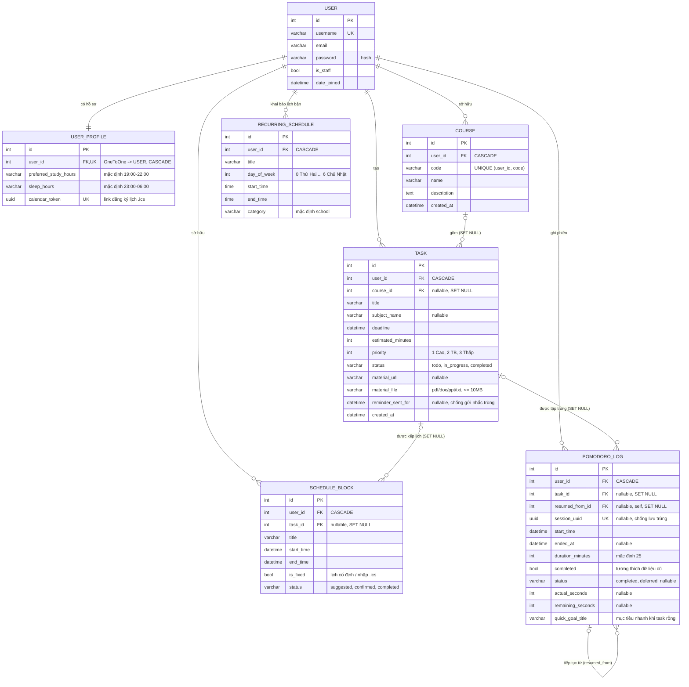

# ERD – StudyPlanner

Sơ đồ quan hệ thực thể của hệ thống, khớp với `planner/models.py` sau migration `0006_userprofile_calendar_token`.

- `USER` là bảng `auth_user` có sẵn của Django (chỉ liệt kê các cột dùng tới).
- `SCHEDULE_BLOCK` đóng vai trò thực thể **Event** trong đề bài (lịch bận cố định, phiên học AI gợi ý, sự kiện nhập từ `.ics`).
- Các trường tính toán (điểm rủi ro trễ hạn, kế hoạch tuần) không lưu trong DB mà được tính từ `TASK`, `SCHEDULE_BLOCK` và `POMODORO_LOG`.

## Quan hệ và ràng buộc

| Quan hệ | Lực lượng | Khi xóa cha |
|---|---|---|
| USER – USER_PROFILE | 1 – 1 | CASCADE |
| USER – COURSE / TASK / RECURRING_SCHEDULE / SCHEDULE_BLOCK / POMODORO_LOG | 1 – N | CASCADE |
| COURSE – TASK | 0..1 – N | SET NULL (task vẫn giữ) |
| TASK – SCHEDULE_BLOCK | 0..1 – N | SET NULL |
| TASK – POMODORO_LOG | 0..1 – N | SET NULL (giữ lịch sử tập trung) |
| POMODORO_LOG – POMODORO_LOG | 0..1 – N (tự tham chiếu) | SET NULL |

Ràng buộc duy nhất: `auth_user.username`, `user_profile.user_id`, `user_profile.calendar_token`, `(course.user_id, course.code)`, `pomodoro_log.session_uuid`.
